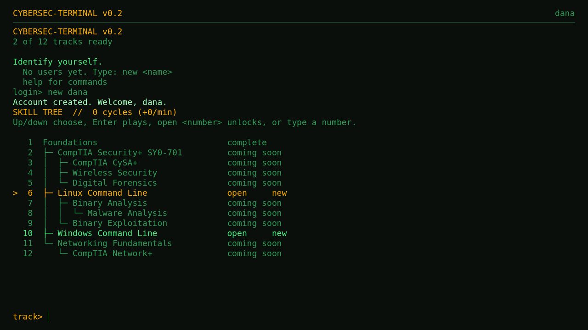
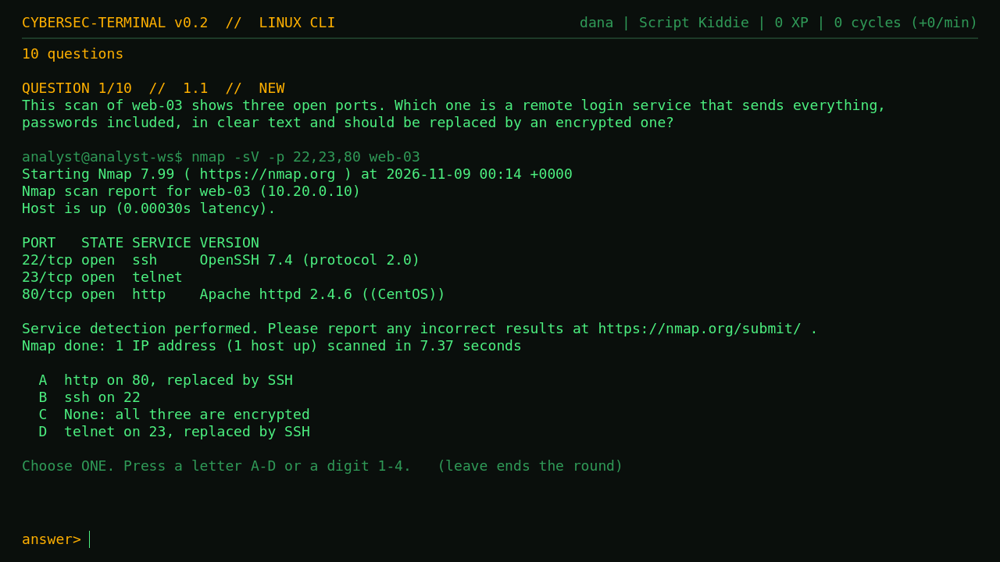
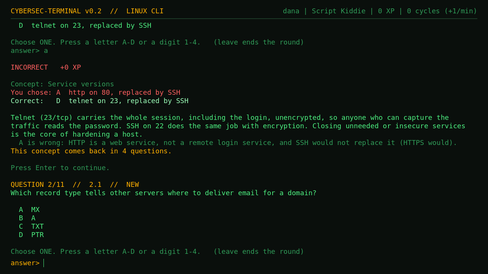
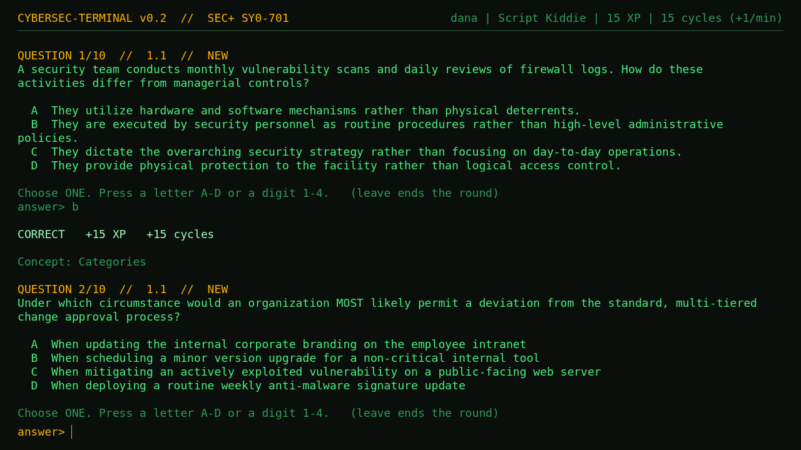

# Cybersec Terminal

A free study game for cybersecurity that runs in your browser. It looks like a retro hacker terminal: you answer
questions, earn XP and a currency called Cycles, work in simulated Linux and Windows command lines, and take timed exams.
Spaced repetition brings back what you are about to forget. Every question, the skill tree and the XP and economy numbers
are plain JSON files that anyone can read and edit.

**Play it:** https://0xbaadfade.github.io/cybersec-terminal/ (nothing to install; your progress is saved in your browser,
on that computer)

## The goal

The aim is a free, curated bank of cybersecurity knowledge for practitioners at every level, from a first Linux command to
expert work. It began as the maintainer's own study bank and grows as they research and learn new topics; anyone is welcome to
add their own content for the community. The game is one way to study it. The questions are plain JSON, so they can be used
anywhere.

Every item records whether it has been reviewed, and by whom: the maintainer (against a cited source) or an AI tool. How an
item was drafted does not matter, and AI help is welcome. Only person-reviewed items count as the *curated* bank; the rest are
labelled and are served after them. `CONTENT-STANDARDS.md` says exactly what that means.

**Where it stands:** 1029 questions in 3 packs; 76 reviewed by a person, 0 by an AI tool. See `ROADMAP.md` for what is built and what
is wanted, and `CONTRIBUTING.md` to help.

A question with simulated tool output, and the feedback after a wrong answer:

Packs are plain folders of JSON, so the game can also play question banks you add yourself. A Security+ question, in the
same terminal:

## What is in it

Content comes in *packs*: a folder of JSON with the questions for one certification or skill. This repository ships:

- Linux Command Line (`packs/linux-cli/`)
- Windows Command Line (`packs/windows-cli/`)
- CompTIA Security+ SY0-701 (`packs/secplus-sy0-701/`)

The skill tree (`data/tracks.json`) also lists branches that are not built yet; they show as "coming soon".

## Make it yours

- **Run from source:** install Godot 4.6.3 (https://godotengine.org/), open `project.godot`, press F5.
- **Add your own questions:** copy `templates/pack/` and read `docs/making-packs.md`. It also lists every tunable number
  in `data/rules.json` (XP, ranks, the Cycles economy, the perk shop).
- **Publish your own copy:** `docs/sharing.md` (a Godot web export hosted on GitHub Pages).
- **Contribute:** see `CONTRIBUTING.md`. The easiest and most useful contribution is a pack of questions you wrote.

Tests live in `tests/unit` (GUT, run headless). Some tests of packs that are not part of this repository are left out, and
comments in the source sometimes cite design notes that are not published here.

## Licence

The code is MIT-licensed (`LICENSE`). The question packs are CC BY 4.0 (`packs/LICENSE.md`). Bundled software (Godot, the
DejaVu Sans Mono font, GUT) is credited in `THIRD-PARTY.md`.

Cybersec Terminal is an independent study aid. It is not made, endorsed or approved by CompTIA or any other certification
body; their names appear only to say what a branch of the skill tree prepares you for.
